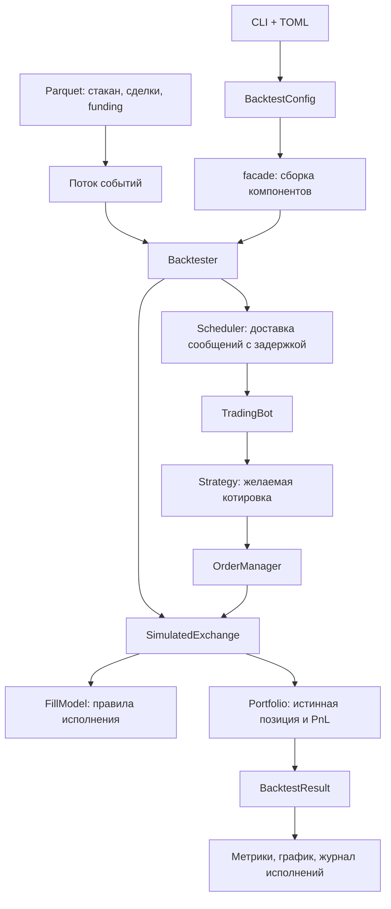

# Справочник по кодбазе и бэктесту

Дата разбора: 9 ноября 2026 года.

Проект — событийный симулятор маркетмейкинга на ETH perpetual. Он воспроизводит рынок, запускает стратегию и считает результат с учётом очереди, задержек, комиссий и funding.

Главный принцип: **биржа хранит истинное состояние, а бот действует по полученным сообщениям**. Сообщения приходят с задержкой. Поэтому бот может временно знать старую цену и старую позицию.

Текст использует короткие предложения и единые термины. Это адаптация принципов [ASD-STE100](https://www.asd-ste100.org/about.html) для русского языка. Формальное соответствие английскому стандарту не измеряется.

## 1. Общая карта

| Термин | Значение в проекте |
|---|---|
| Стакан | Снимок цен и объёмов заявок рынка |
| `mid` | Среднее между лучшими bid и ask |
| Котировка, `Quote` | Желаемые цены покупки и продажи |
| Ордер, `Order` | Заявка, которую бот отправил на биржу |
| Исполнение, `Fill` | Факт покупки или продажи части ордера |
| Позиция | Количество ETH: плюс означает long, минус означает short |
| PnL | Прибыль или убыток |
| bp | Базисный пункт: `1 bp = 0.01%` |



Текстовая версия схемы:

```text
CLI + TOML → BacktestConfig → facade → Backtester
Parquet → поток событий → Backtester → SimulatedExchange → FillModel
                                           ↓
                                       Portfolio → BacktestResult → отчёт

Backtester → Scheduler → TradingBot → Strategy → Quote → OrderManager
                                                              ↓
                                                       SimulatedExchange
```

| Компонент | Ответственность |
|---|---|
| [config.py](mm/config.py) | Загружает и проверяет настройки |
| [facade.py](mm/facade.py) | Создаёт компоненты и соединяет их |
| [data/loader.py](mm/data/loader.py) | Читает данные и строит поток событий |
| [strategy/](mm/strategy/) | Рассчитывает желаемую котировку |
| [trading/bot.py](mm/trading/bot.py) | Реагирует на доступные боту сообщения |
| [trading/order_manager.py](mm/trading/order_manager.py) | Отправляет новые ордера и отменяет старые |
| [backtester/engine.py](mm/backtester/engine.py) | Управляет временем и обработкой событий |
| [backtester/exchange.py](mm/backtester/exchange.py) | Управляет ордерами на стороне биржи |
| [backtester/fill_models.py](mm/backtester/fill_models.py) | Определяет объём исполнения |
| [backtester/portfolio.py](mm/backtester/portfolio.py) | Считает позицию, комиссии и PnL |
| [analytics/](mm/analytics/) | Рассчитывает метрики и строит графики |

## 2. Полный путь бэктеста

### Шаг 1. CLI создаёт конфигурацию

Точка входа — [run_backtest.py](run_backtest.py), функция `main()`.

```powershell
python run_backtest.py --set strategy.max_position=2
```

Программа:

1. Читает `configs/default.toml`.
2. Применяет параметры `--set`.
3. Создаёт отдельные конфигурации для `--sweep`.
4. Запускает каждый вариант последовательно.
5. Сохраняет отчёты.
6. Выводит таблицу метрик.

Несколько `--sweep` создают все сочетания значений. Два правила исполнения и три размера ордера дают шесть прогонов.

`BacktestConfig` проверяет значения и переводит единицы:

- миллисекунды → наносекунды;
- комиссии в bp → доли;
- часы funding → интервал в наносекундах.

Внутри симулятора время представлено целыми числами в наносекундах.

Настройки по умолчанию:

| Параметр | Значение |
|---|---|
| Стратегия | `MidQuoter` |
| Размер ордера | 1 ETH |
| Лимит позиции | ±10 ETH |
| Шаг цены | 0.1 USD |
| Половина спреда стратегии | 0.05 USD |
| Модель очереди | `queue` |
| Правило пересечения стакана | `confirmed` |
| Правило отмен в очереди | `pro_rata` |
| Задержки: данные / ордер / отчёт об исполнении | 1 / 2 / 2 мс |

### Шаг 2. Facade собирает систему

`facade.run_backtest()` выбирает источник данных и создаёт движок.

Функции сборки создают `FillModel`, `SimulatedExchange`, `Strategy`, `FeedLatency` и `Backtester`.

Сам `Backtester` создаёт бота, менеджер ордеров, портфель и планировщик сообщений.

Это единое место сборки. CLI и сценарные тесты используют эти функции.

### Шаг 3. Загрузчик превращает таблицы в события

`ParquetDataSource` читает три набора:

```text
data/orderbook/<дата>.parquet
data/trades/<дата>.parquet
data/fundings/<дата>.parquet
```

Загрузчик читает данные по дням. Внутри дня `build_events()` объединяет и сортирует события.

| Тип события | Значение |
|---|---|
| `BookSnapshot` | Новый снимок стакана |
| `Trade` | Историческая сделка |
| `FundingRate` | Новая опубликованная ставка |
| `FundingSettlement` | Момент расчёта funding |

При одинаковом времени порядок такой:

```text
FundingSettlement → FundingRate → Trade → BookSnapshot
```

Сделка идёт перед стаканом. Модель сначала учитывает проторгованный объём, затем видит оставшийся объём.

Позиция и ордера сохраняются между днями. Дневные файлы входят в один непрерывный прогон.

### Шаг 4. Движок обрабатывает событие

Основной цикл находится в `Backtester.run()`.

Для каждого события движок:

1. Доставляет боту сообщения, время которых строго меньше времени события.
2. Передаёт событие бирже.
3. Применяет полученные исполнения к истинному портфелю.
4. Обновляет рыночное состояние.
5. Планирует сообщения боту.
6. При необходимости записывает состояние портфеля.

Здесь существуют две разные очереди действий:

- `Scheduler` хранит отложенные сообщения боту.
- Биржа хранит время прихода каждого ордера и отмены.

`Scheduler` использует `heapq`. При одинаковом времени сообщения доставляются в порядке постановки.

**Рыночные события с одинаковым временем проходят раньше сообщений боту с этим временем.** Бот не может отреагировать между сделками одного sweep.

### Шаг 5. Бот получает стакан и рассчитывает котировку

`TradingBot` хранит:

```text
book      — последний полученный стакан
position  — позицию по полученным отчётам об исполнении
orders    — менеджер собственных заявок
```

Когда приходит стакан, бот вызывает:

```python
strategy.quote(book, position)
```

Стратегия возвращает `Quote`:

```text
bid   — желаемая цена покупки
ask   — желаемая цена продажи
size  — размер ордера
```

`None` вместо цены означает: снять котировку этой стороны.

Бот также пересчитывает котировку после отчёта об исполнении и обновления funding.

Если стакан слишком старый, бот снимает обе стороны. Движок ставит отдельный таймер. Новый снимок для срабатывания таймера не требуется.

### Шаг 6. Менеджер превращает котировку в заявки

`OrderManager.sync()` сравнивает желаемую цену с заявками, которые известны боту.

| Ситуация | Действие |
|---|---|
| Цена прежняя | Оставить ордер |
| Цена изменилась | Отменить старый ордер и отправить новый |
| Сторона отключена | Отменить ордер |
| Ордер полностью исполнен и отчёт получен | При необходимости отправить новый |

**Частичное исполнение не вызывает пополнение ордера.** Остаток стоит до изменения цены или полного исполнения.

После запроса отмены менеджер сразу забывает старый ордер. Биржа отменит его только после задержки.

Старый ордер может исполниться, пока новый уже находится в пути. Поздний отчёт всё равно изменит известную боту позицию.

### Шаг 7. Биржа активирует и исполняет ордер

`SimulatedExchange` хранит истинные ордера.

```text
active_at = время отправки + задержка ордера
cancel_at = время запроса отмены + задержка ордера
```

Биржа применяет наступившие приходы в начале обработки следующего рыночного события.

Если новый ордер сразу пересекает последний известный бирже стакан, он исполняется как taker. Модель использует лучшую встречную цену и taker-комиссию.

Остальные исполнения определяет `FillModel`.

### Шаг 8. Исполнение обновляет портфель и затем доходит до бота

Истинная позиция меняется сразу при обработке исполнения.

Бот узнаёт о нём позже:

```text
время сообщения = время исполнения + ack latency
```

Движок дополнительно запрещает доставку раньше текущего обрабатываемого события.

Поэтому одновременно может существовать такое состояние:

```text
Истинная позиция: +1 ETH
Известная боту позиция: 0 ETH
```

Лимит позиции мягкий. Стратегия проверяет известную позицию. Ещё не полученные исполнения могут привести к превышению лимита.

### Шаг 9. Движок завершает прогон

После последнего рыночного события движок доставляет оставшиеся сообщения боту. Затем он записывает финальный портфель.

**Оставшаяся позиция не закрывается принудительно.** Она оценивается по последнему `mid`.

Результат содержит:

- историю PnL и позиции;
- журнал исполнений;
- статистику ордеров;
- общий рыночный объём;
- историю изменения `mid`.

CLI сохраняет PNG, JSON с метриками и Parquet с исполнениями. Полная конфигурация входит в JSON.

## 3. Стратегии

### MidQuoter

Реализация: [mid_quoter.py](mm/strategy/mid_quoter.py).

```text
mid = (best_bid + best_ask) / 2

bid = округлить вниз(mid − half_spread)
ask = округлить вверх(mid + half_spread)
```

Округление выполняется по шагу цены.

Пример:

```text
Стакан:       2200.0 / 2200.1
mid:          2200.05
half_spread:  0.05

Наш bid:      2200.0
Наш ask:      2200.1
```

Стратегия ставит обе стороны на лучшие цены.

`InventoryLimit` отключает сторону, если ещё один полный лот нарушит лимит. При позиции `+10 ETH` покупка отключена, продажа разрешена.

У `MidQuoter` нет прогноза направления цены. Он не сдвигает цены из-за накопленной позиции.

### FairValueQuoter

Реализация: [fair_value.py](mm/strategy/fair_value.py).

```text
fair =
    mid × (1 + signal_bp / 10000 − funding_rate × funding_fair_hours)
    − inventory_skew × (position − target_position)
```

| Часть | Воздействие |
|---|---|
| Положительный прогноз | Сдвигает центральную цену вверх |
| Отрицательный прогноз | Сдвигает центральную цену вниз |
| Позиция выше целевой | Сдвигает цены вниз и поощряет продажу |
| Позиция ниже целевой | Сдвигает цены вверх и поощряет покупку |
| Положительный funding | Может задавать целевую короткую позицию |

Стратегия ставит bid и ask вокруг `fair`.

Дополнительные ограничения:

- `signal_cap_bp` ограничивает величину прогноза.
- `pull_threshold_bp` отключает сторону при неблагоприятном прогнозе.
- Bid ограничен сверху лучшим bid полученного стакана.
- Ask ограничен снизу лучшим ask полученного стакана.

Последние два ограничения поддерживают пассивную котировку по наблюдаемому стакану. При приходе ордера рынок уже может измениться. Тогда биржа допускает taker-исполнение.

## 4. Модель исполнения

Реализация: [fill_models.py](mm/backtester/fill_models.py).

`SimpleFillModel` считает, что перед нами нет очереди. Это оптимистичное допущение.

`QueueAwareFillModel` ставит наш ордер за видимым объёмом на его цене.

```text
Перед нами:       5 ETH
Наш ордер:        1 ETH
Продажа по цене:  5.4 ETH

Сначала уходит очередь: 5 ETH
Наш fill:                0.4 ETH
Наш остаток:             0.6 ETH
```

Рост объёма уровня считается добавлением заявок за нами.

Уменьшение объёма зависит от `cancel_rule`:

| Правило | Предположение |
|---|---|
| `back` | Отмены происходят сначала за нами |
| `pro_rata` | Отмены распределены пропорционально |
| `front` | Отмены происходят сначала перед нами |

Модель отдельно учитывает сделки, которые прошли сквозь нашу цену. Продажа ниже нашего bid означает, что наш bid мог получить исполнение.

Биржа распределяет объём сделки между нашими ордерами по цене и времени. Один объём сделки не используется повторно для наших исполнений.

### Пересечение нашей цены стаканом

Снимок может показать пересечение без достаточного объёма исторических сделок.

Параметр `cross_rule` определяет реакцию:

| Правило | Когда исполняется остаток |
|---|---|
| `never` | Снимок сам по себе не исполняет ордер |
| `confirmed` | Сделки достигли цены и очистили очередь перед нами |
| `profitable` | Выполнено `confirmed` либо контрагенту выгодно забрать старую котировку |
| `always` | Любое пересечение исполняет остаток |

`profitable` моделирует контрагента, который использует устаревшую котировку.

`pickoff_fair_ms > 0` разрешает этой модели использовать будущий `mid`. Бот его не получает. Это явное допущение об информации контрагента, которое меняет результаты исполнения.

## 5. Учёт PnL

Реализация: [portfolio.py](mm/backtester/portfolio.py).

`Portfolio` использует среднюю цену позиции.

При покупке позиция увеличивается. Денежные средства уменьшаются на стоимость покупки и комиссию.

При продаже происходит обратное изменение позиции и денежных средств.

При закрытии части позиции появляется реализованный PnL. При перевороте остаток новой позиции получает цену текущего исполнения.

```text
unrealized = position × (mid − avg_price)

equity = cash + position × mid

equity = realized + unrealized − fees + funding
```

Портфель начинает с нулевой позиции и нулевых денежных средств. `equity` выражает накопленный PnL. Начальный инвестиционный капитал отдельно не моделируется.

Funding:

```text
payment = −position × mid × rate
```

При положительной ставке long платит, short получает.

### Метрики

Реализация: [metrics.py](mm/analytics/metrics.py), функция `compute_metrics()`.

- Общий PnL и его составляющие.
- PnL в bp от торгового оборота.
- Просадка в USD.
- Sharpe по часовым изменениям PnL.
- Статистика исполнений.
- Средняя и максимальная абсолютная позиция.
- Преимущество цены исполнения относительно `mid`.
- Markout через 1 и 60 секунд.

**Markout показывает, что произошло с ценой после исполнения.** Если после покупки цена падает, markout ухудшается. Так проект измеряет неблагоприятный отбор исполнений.

## 6. ML-путь

Обучение выполняется отдельно от бэктеста: [train_fair_value.py](train_fair_value.py).

```text
История стакана и сделок
→ признаки
→ обучение и валидация
→ прогнозы на тестовые дни
→ fair_value_signal.parquet
→ SignalTable
→ FairValueQuoter
```

Признаки:

- дисбаланс объёмов bid и ask;
- microprice;
- недавние изменения цены;
- изменения стакана, OFI;
- направленный поток сделок;
- объём и волатильность.

[build_features()](mm/signals/features.py) использует данные с временем не позднее текущего снимка.

Цель — изменение `mid` через одну секунду, выраженное в bp.

Скрипт сравнивает три модели:

1. Ridge на всех признаках.
2. Ridge только на microprice.
3. Градиентный бустинг.

Последние 20% обучающих строк используются для валидации. Перед ними оставлен разрыв в одну секунду для разделения целевых горизонтов.

Лучшая модель выбирается по validation R². В текущей реализации её используют без дополнительного обучения на всём обучающем дне.

[SignalTable](mm/signals/signal.py) ищет прогноз по точному времени полученного снимка. Если прогноза нет, возвращается ноль.

Во время бэктеста модель не обучается. Стратегия читает готовую таблицу прогнозов.

## 7. Ключевые паттерны

| Паттерн | Где применяется | Зачем |
|---|---|---|
| Событийная обработка | `Backtester` | Сохраняет порядок рыночных событий и реакций |
| Strategy | `Strategy`, `FillModel` | Позволяет менять алгоритм котирования и исполнения |
| Facade | `mm/facade.py` | Даёт простой вход для запуска |
| Внедрение зависимостей через конструкторы | Движок, биржа, бот | Позволяет передавать нужную реализацию напрямую |
| Узкий интерфейс | `OrderGateway` | Ограничивает потребности менеджера методами `submit` и `cancel` |
| Разделение состояния | `Portfolio`, `TradingBot`, `OrderTicket` | Удерживает различие между истиной и знаниями бота |

Чтобы добавить стратегию, нужен новый класс `Strategy` и ветка сборки в facade. Основной событийный цикл можно сохранить.

Чтобы добавить модель исполнения, нужен новый класс `FillModel` и подключение в сборке.

Интерфейс `OrderGateway` допускает подключение другого адаптера биржи. Готовый live-адаптер в этой кодбазе не реализован.

## 8. Границы модели

- Наши ордера не изменяют исторический рынок.
- Очередь восстанавливается приблизительно по снимкам L2.
- Taker-исполнение использует весь размер по лучшей встречной цене, без прохода по глубине.
- Финальная позиция оценивается по `mid`, без расходов на принудительное закрытие.

Деталь настройки funding: расчёт платежа масштабирует ставку через `interval_hours / rate_hours`. Стратегия получает опубликованную ставку напрямую. При изменении этих периодов единицы внутри формулы fair value требуют отдельной проверки.

## 9. Порядок чтения исходников

1. [facade.py](mm/facade.py): сборка системы.
2. [engine.py](mm/backtester/engine.py): основной цикл.
3. [bot.py](mm/trading/bot.py): реакция бота.
4. [mid_quoter.py](mm/strategy/mid_quoter.py): простой расчёт котировки.
5. [order_manager.py](mm/trading/order_manager.py): управление заявками.
6. [exchange.py](mm/backtester/exchange.py): жизненный цикл ордера.
7. [fill_models.py](mm/backtester/fill_models.py): правила исполнения.
8. [portfolio.py](mm/backtester/portfolio.py): учёт результата.
9. [test_backtest_scenarios.py](tests/test_backtest_scenarios.py): примеры с ожидаемыми значениями.

Проследи один сценарий: стакан → котировка → ордер → сделка → исполнение → PnL.

## 10. Состояние проверки при подготовке справочника

Исходники были прочитаны. При запуске тестов 86 проверок прошли. Ещё 3 теста не смогли запуститься из-за доступа к временным папкам.

Полный исторический бэктест в рамках этого разбора не перезапускался. Этот файл описывает состояние кодбазы на дату разбора.
